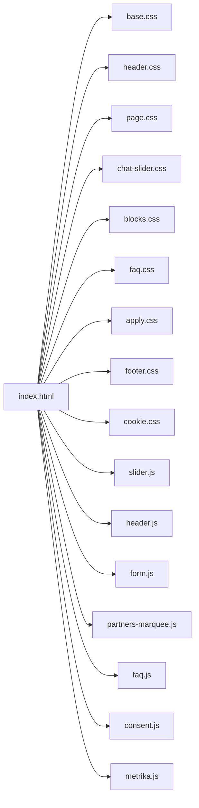
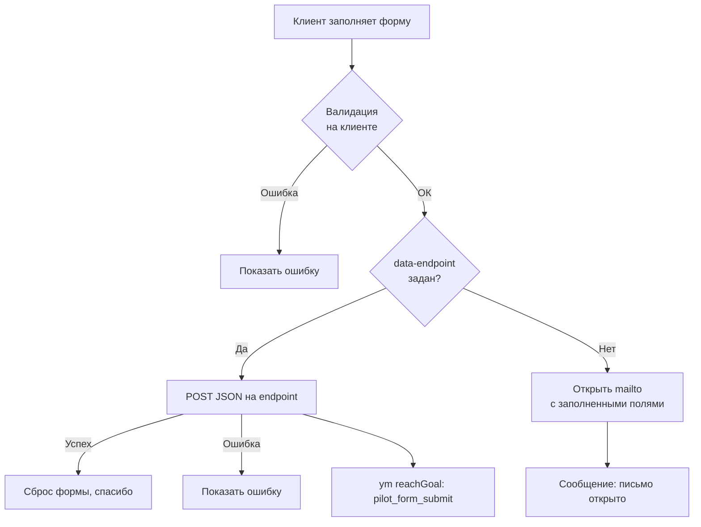
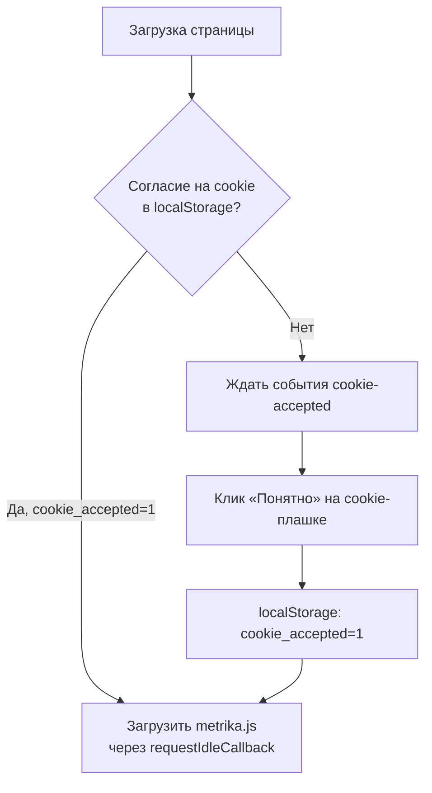

# AGENTS.md — Vin-Scan Public Site

## Overview

**Vin-Scan** — это SaaS-сервис интеллектуального подбора автозапчастей по фото СТС/ПТС и VIN для магазинов и автосервисов на платформе ABCP. Данный репозиторий содержит **публичный одностраничный лендинг** сервиса, размещённый на [https://vin-scan.ru](https://vin-scan.ru).

Сайт выполняет исключительно презентационную функцию: рассказывает о продукте, тарифах, условиях пилота, содержит форму заявки и юридические документы. Сам сервис Vin-Scan (чат-бот, распознавание СТС, подбор деталей) работает как внешняя система и **не входит** в этот репозиторий.

---

## Tech Stack

| Технология | Назначение |
|---|---|
| **HTML5** (plain, валидируется `html-validate`) | Разметка всех страниц |
| **CSS3** (модульные файлы, CSS-переменные, media queries) | Стилизация (чистый CSS, без препроцессоров) |
| **JavaScript** (Vanilla JS, ES2021+, IIFE-модули) | Клиентская интерактивность (без фреймворков) |
| **Yandex Object Storage** (S3-совместимое хранилище) | Хостинг статики |
| **GitHub Actions** | CI/CD: валидация HTML + деплой |
| **html-validate** (v11.16.2) | Линтер HTML (строгие правила) |
| **eclint** | Автоформатирование по `.editorconfig` |
| **EditorConfig** | Настройки форматирования кода |
| **Schema.org / JSON-LD** | Микроразметка для поисковиков |
| **Open Graph / Twitter Cards** | Разметка для соцсетей |
| **Яндекс.Метрика** | Веб-аналитика (счётчик с согласием на cookie) |

**Важно:** Node.js не используется в рантайме — проект является чистой статикой (нет бэкенда, нет `package.json`, нет сборщиков вроде Webpack/Vite). Однако Node.js применяется для **тулинга**: линтер `html-validate` и форматировщик `eclint` запускаются через `npx` как локально, так и в GitHub Actions.

---

## Project Structure

```
vin-scan-public-site/
│
├── AGENTS.md                          # Этот файл (правила для AI-агентов)
├── .rules.md                          # ★ ПЕРВОИСТОЧНИК: палитра, архитектура CSS, брейкпоинты. Сверяться при работе со стилями
├── README.md                          # Основная документация проекта
├── .editorconfig                      # Форматирование (2 пробела, UTF-8, final newline)
├── .htmlvalidate.json                 # Конфигурация валидатора HTML
├── .gitattributes / .gitignore        # Git-настройки
│
├── .github/workflows/
│   ├── deploy.yml                     # Валидация HTML + деплой в Yandex Object Storage
│   └── auto-format.yml                # Автоформатирование через eclint
│
├── demo/                              # Прототипы (не деплоятся)
│   ├── section.html                   # HTML-заготовка демо-блока с видео (ждёт ролик)
│   └── demo.css                       # Стили для демо-блока
│
├── site/                              # ★ КОРЕНЬ САЙТА (деплоится в бакет)
│   ├── index.html                     # Главная страница (лендинг)
│   ├── consent/index.html             # Согласие на обработку ПД
│   ├── privacy/index.html             # Политика конфиденциальности
│   │
│   ├── css/
│   │   ├── base.css                   # Токены палитры, сброс, типографика, кнопки, контейнер
│   │   ├── layout/
│   │   │   ├── header.css             # Шапка (sticky, бургер, телефон+мессенджеры)
│   │   │   └── footer.css             # Подвал (сетка колонок, партнёры, статус сервиса)
│   │   ├── blocks/
│   │   │   ├── page.css               # Hero, шаги, аудитория, адаптив
│   │   │   ├── blocks.css             # Цифры, интеграции, пилот, тарифы, о нас, партнёры
│   │   │   ├── faq.css                # FAQ-аккордеон
│   │   │   └── apply.css              # Блок заявки с формой
│   │   ├── components/
│   │   │   ├── chat-slider.css        # Слайдер скриншотов чата
│   │   │   └── cookie.css             # Cookie-плашка
│   │   └── legal/
│   │       └── legal.css              # Стили юридических страниц
│   │
│   ├── js/
│   │   ├── header.js                  # Sticky-шапка, бургер-меню, скролл
│   │   ├── slider.js                  # Карусель скриншотов (scroll-snap, автопрокрутка)
│   │   ├── faq.js                     # Аккордеон FAQ (анимация Web Animations API)
│   │   ├── form.js                    # Форма заявки (валидация, POST/mailto, метрика)
│   │   ├── metrika.js                 # Яндекс.Метрика (отложенная загрузка)
│   │   ├── consent.js                 # Управление cookie-плашкой
│   │   └── partners-marquee.js        # Бегущая лента партнёров
│   │
│   └── img/
│       ├── logo_header.svg            # Логотип для шапки (основа без шестерни)
│       ├── logo_gear.svg              # Шестерня для анимации логотипа
│       ├── logo_full.svg              # Полный логотип (векторный оригинал)
│       ├── logo_wordmark.svg          # Текстовая часть логотипа
│       ├── logo_medium.svg            # Средний логотип
│       ├── logo_small.svg / .png      # Маленький логотип (favicon/PWA)
│       ├── logo-max.svg               # Логотип мессенджера MAX
│       ├── og-cover.png               # Open Graph-изображение 1200×630
│       ├── favicon.svg                # Векторная иконка сайта
│       ├── chat/
│       │   ├── chat-1.jpg ... chat-4.jpg  # Скриншоты чата для слайдера
│       ├── partners/
│       │   ├── autoshop82.webp ... pit-stop.webp  # Логотипы партнёров
│       └── review/
│           └── remzi.png              # Аватар отзыва
│
└── state/                             # Пусто (зарезервировано)
```

---

## Commands

### Локальный просмотр

Запускать сервер **только из папки `site/`**, иначе абсолютные пути `/css/...` не найдутся:

```sh
cd site
python3 -m http.server 8000
# или
npx --yes serve .
```

### Валидация HTML

```sh
npx --yes html-validate@11.16.2 "site/**/*.html"
```

### Форматирование (EditorConfig)

```sh
npx eclint fix "**/*"
```

### Деплой

Автоматический при push в `main` (GitHub Actions). Не требует ручных команд.

---

## Key Architecture & Data Flow

### Как устроен сайт

Проект представляет собой **чистый статический сайт** с единственной точкой входа — `site/`, которая синхронизируется с корнем бакета Yandex Object Storage. Все пути в HTML начинаются с `/` (например, `/css/base.css`) — это абсолютные URL, которые на проде ведут в корень сайта, а на диске соответствуют `site/css/base.css`.

**Схема подключения CSS и JS на главной странице:**



### Форма заявки (data flow)



- `data-endpoint` — если указан, заявка уходит POST-запросом (JSON). Сейчас **пустой** — форма открывает email.
- `data-mailto` — `contact@vin-scan.ru` (запасной вариант).

### Яндекс.Метрика (data flow)



### Распознавание СТС и подбор деталей

> **Важно:** сам сервис Vin-Scan (распознавание СТС/ПТС, определение VIN, подбор запчастей) **не входит** в этот репозиторий. Сайт только презентует сервис и собирает заявки. Бэкенд и чат-бот находятся в других репозиториях.

На сайте описана следующая логика работы Vin-Scan (для контекста):

1. Клиент отправляет фото СТС/ПТС или текстовый запрос в чат (Telegram, MAX, виджет на сайте).
2. Vin-Scan распознаёт данные автомобиля через Yandex Vision OCR (фото не сохраняется).
3. Система определяет VIN и подбирает совместимые детали по каталогам производителей и прайс-листу магазина.
4. Менеджер проверяет результат и отправляет ответ клиенту.

---

## Code Conventions & Agent Guidelines

### HTML

- **Пути:** все URL в `href` и `src` начинаются с `/` (например, `/css/base.css`). Никогда не добавлять `site/` в пути.
- **Валидация:** запрещён атрибут `style="..."` (правило `no-inline-style: error`). Запрещён тег `<style>...</style>` в HTML (правило `no-style-tag: error`).
- **Микроразметка:** Schema.org (JSON-LD) в `<head>` для Organization, WebSite, SoftwareApplication.
- **Доступность:** используйте `aria-label`, `aria-labelledby`, `aria-hidden`, `role`, `visually-hidden` для скринридеров. Skip-link в начале `<body>`.
- **Форма:** `novalidate` на форме, ручная валидация через JavaScript. Чекбоксы-чипсы со скрытым нативным `<input>`.

### CSS

- **Именование:** BEM-подобное (блок__элемент--модификатор). Примеры: `.header__logo`, `.btn--primary`, `.chat-slider__btn`, `.faq__item.is-open`.
- **Токены:** все цвета только через CSS-переменные `var(--brand-*)` из `base.css`. Исключения: цвета соцсетей (VK, Telegram), светофоры чата, `#000` в mask-image.
- **Первоисточник:** файл `.rules.md` является эталонным документом для токенов палитры, правил вёрстки, архитектуры CSS и брейкпоинтов. При любых работах со стилями агент обязан сверяться с `.rules.md` и не нарушать описанные там ограничения.
- **Порядок подключения** на главной: `base.css` → `header.css` → `page.css` → `chat-slider.css` → `blocks.css` → `faq.css` → `apply.css` → `footer.css` → `cookie.css`.
- **На юридических страницах:** `base.css` → `legal.css` → `cookie.css`.
- **Медиа-запросы:** строго по брейкпоинтам (1180, 900, 640, 480). Без крайней необходимости новые не добавлять.
- **prefers-reduced-motion:** все анимации и переходы обнуляются при `(prefers-reduced-motion: reduce)`.
- **Адаптив:** `scroll-padding-top` настроен для липкой шапки (7.5rem десктоп, 5rem мобильный).
- **Не использовать** `!important` без крайней необходимости.

### JavaScript

- **Модульность:** каждый файл — самовызывающаяся функция `(() => { ... })()`, либо слушатель `DOMContentLoaded`.
- **Независимость модулей:** скрипты не имеют межмодульных зависимостей и глобального состояния. Каждый модуль автономен и может быть добавлен или удалён без влияния на остальные. Единственные точки связности между модулями:
  - кастомное событие `cookie-accepted` (генерируется `consent.js`, потребляется `metrika.js`);
  - глобальный объект `window.ym` (предоставляется `metrika.js`, вызывается из `form.js`).
- **Именование:** camelCase. Константы UPPER_SNAKE_CASE.
- **Работа с DOM:** `querySelector`, `querySelectorAll` — без jQuery и других библиотек.
- **Анимации:** Web Animations API (`element.animate()`) для плавных переходов. CSS-переходы для простых эффектов.
- **Доступность:** управление `aria-expanded`, `aria-label`, `aria-live`, `aria-current`. Фокус при открытии/закрытии.
- **Производительность:** `requestAnimationFrame` для scroll-событий, IntersectionObserver для видимости, пассивные слушатели.
- **Обработка ошибок:** try/catch с тихим fallback (не ломать страницу), `finally` для снятия блокировки кнопки.
- **localStorage:** чтение/запись обёрнуты в try/catch (может быть недоступно).
- **Метрика:** вызов `window.ym()` через глобальную функцию. Отложенная загрузка через `requestIdleCallback`.

### Куда добавлять новый функционал

| Что нужно сделать | Куда |
|---|---|
| Новая секция на главной | Создать CSS-файл в `site/css/blocks/` или `site/css/components/`, подключить в `<head>` index.html |
| Новый компонент (слайдер, плашка, модалка) | CSS в `site/css/components/`, JS в `site/js/` |
| Новый скрипт | `site/js/` (самовызывающаяся функция), подключить через `<script defer>` |
| Новый логотип/изображение | `site/img/` (векторы — SVG, растры — WebP/PNG) |
| Новая юридическая страница | `site/<page>/index.html`, CSS в `site/css/legal/legal.css` |
| Демо/прототип | `demo/section.html` + `demo/demo.css` (не деплоится) |
| Изменение палитры | Только в `site/css/base.css` (:root), через CSS-переменные |

### Git Conventions

- **Сообщения коммитов** писать на русском языке в повелительном / инфинитивном наклонении (например: «Добавить секцию тарифов», «Исправить отступ в подвале», «Обновить контакты в шапке»).
- **Не коммитить** служебные файлы ОС (`.DS_Store`, `Thumbs.db`) и не трогать ветки кроме целевой.
- **Форматирование** выполняется автоматически через GitHub Actions (`auto-format.yml`), которое создаёт дополнительный коммит `style: auto-format via \`.editorconfig\``. Не нужно форматировать код вручную.

### Ограничения и осторожность

1. **Не добавлять `site/` в пути HTML** — на проде такого пути нет.
2. **Не использовать inline-стили и `<style>`** — CI отклонит сборку.
3. **Флаг `--delete` в деплое** — удаляет из бакета всё, чего нет в `site/`. Любые файлы, загруженные вручную в бакет, нужно хранить внутри `site/` или убрать флаг.
4. **`data-endpoint` в форме пустой** — заявки уходят на email. Если появится бэкенд, нужно указать URL.
5. **Все изображения — WebP** (кроме логотипов SVG/PNG и аватара PNG). Ширина до 480px для партнёрских логотипов.
6. **Файлы `demo/` не деплоятся** — не размещать там критичный контент.
7. **Брейкпоинты 1180, 900, 640, 480** — строго по ним. Новые только с согласованием.
8. **favicon.svg** — иконка сайта с пинами на координатной сетке (маска). Содержит несколько `<linearGradient>`. Не менять без необходимости.
9. **Логотип разбит на две части** — `logo_header.svg` (основа) и `logo_gear.svg` (шестерня) для анимации вращения при `:hover`. Обе части обязательны в связке.
10. **Cookie-плашка и метрика** связаны: метрика загружается только после согласия (событие `cookie-accepted`). Согласие хранится в `localStorage` под ключом `cookie_accepted`.
11. **Каталог `state/` зарезервирован** под системные нужды — агенту запрещено удалять его, перемещать или сохранять туда временные файлы, логи и пользовательские данные.
