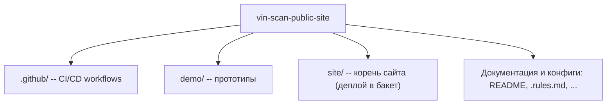

# Vin-Scan

Публичный сайт сервиса: https://vin-scan.ru

Сайт лежит в `site/`: эта папка выгружается в бакет и служит корнем для абсолютных путей `/css/...`, `/js/...` и `/img/...`.

Поэтому в HTML пути начинаются с `/` и при переносе в `site/` не меняются: `/css/base.css` в браузере превращается в `site/css/base.css` на диске и в `css/base.css` в бакете. Добавлять `site/` в `href` и `src` нельзя -- на проде такого пути нет.

## Структура репозитория



```text
vin-scan-public-site/
├── .github/workflows/
│   ├── deploy.yml            валидация HTML и синхронизация site/ с Yandex Object Storage
│   └── auto-format.yml       автоформатирование через .editorconfig
├── demo/                     локальные HTML/CSS-заготовки секций
├── site/                     публикуемый корень сайта
│   ├── index.html            главная страница
│   ├── consent/              согласие на обработку ПД
│   ├── privacy/              политика конфиденциальности
│   ├── css/                  стили (base, layout, blocks, components, legal)
│   ├── js/                   клиентские скрипты (FAQ, слайдер, форма, шапка, метрика)
│   ├── img/                  векторные и растровые ассеты, логотипы, чат, партнёры
│   ├── favicon.svg           векторная иконка сайта
│   ├── site.webmanifest      манифест PWA
│   ├── robots.txt            инструкции для поисковиков
│   └── sitemap.xml           карта сайта
├── .rules.md                 правила разработки, ограничения HTML и CSS-архитектура
└── README.md
```

## Логотип компании

Логотипы компании лежат в папке [site/img/](site/img/). Для анимации шестерёнки в шапке и подвале логотип разделён на неподвижную основу [`site/img/logo_header.svg`](site/img/logo_header.svg) и вращающийся слой [`site/img/logo_gear.svg`](site/img/logo_gear.svg); цельный [`site/img/logo_full.svg`](site/img/logo_full.svg) остаётся как базовый векторный оригинал.

## Изображения

Логотипы партнёров и прочие изображения хранятся в WebP с шириной до 480 px. Логотипы сайта и обложка остаются в SVG / PNG.

## Стили и правила разработки

Подробное руководство по стилям, палитре, ховерам, брейкпоинтам и ограничениям HTML вынесено в документ [.rules.md](.rules.md). **Убедительная просьба соблюдать правила оттуда.**

## Кеширование

[`.github/workflows/deploy.yml`](.github/workflows/deploy.yml) отдаёт все файлы с `Cache-Control: no-cache, must-revalidate`: браузер хранит копию, но перед каждым использованием проверяет её на сервере. Если файл не менялся, приходит `304 Not Modified` без тела ответа. Поэтому после деплоя никто не видит старую вёрстку, а повторные визиты не перекачивают стили, скрипты и картинки заново.

## Деплой

Для деплоя используется [deploy.yml](.github/workflows/deploy.yml). При push в `main` он проверяет HTML и выгружает сайт в Yandex Object Storage, при pull request выполняется только проверка. Ручной запуск доступен через `workflow_dispatch`.

В бакет выгружается содержимое [site/](site/): это корень сайта. [`README.md`](README.md), [`.editorconfig`](.editorconfig), [`.htmlvalidate.json`](.htmlvalidate.json), папка [demo/](demo/) и прочее остаются в репозитории.

> [!important]
> Флаг `--delete` удаляет из бакета всё, чего нет в `site/`, поэтому любые файлы, загруженные отдельно, нужно хранить внутри `site/` или убрать этот флаг.

### Локальный просмотр

Запускайте сервер из папки `site/`, иначе абсолютные пути `/css/...` и `/img/...` не найдутся:
```sh
cd site
python3 -m http.server 8000
```

## Форматирование и валидация HTML

Для форматирования используется [.gitattributes](.gitattributes) и [.editorconfig](.editorconfig) ([auto-format.yml](.github/workflows/auto-format.yml) создаёт дополнительный коммит `style: auto-format via '.editorconfig'` при необходимости, подробнее на [editorconfig.org](https://editorconfig.org/)).

Для валидации HTML реализуется через шаг `validate` в [deploy.yml](.github/workflows/deploy.yml), блокирующей push / PR в случае ошибок вёрстки (подробнее [html-validate](https://html-validate.org/)).

Валидатор отклоняет пуш или PR в следующих случаях:
- не закрыты или некорректно вложены теги
- нарушена базовая структура HTML-документа
- использованы inline-стили через атрибут `style="..."`
- использованы блоки стилей через тег `<style>...</style>`

Конфигурация проверки находится в [.htmlvalidate.json](.htmlvalidate.json).

Запустить проверку локально можно командой:

```sh
npx --yes html-validate@11.16.2 "**/*.html"
```

## Яндекс Метрика

Счётчик Яндекс Метрики вынесен в отдельный файл [site/js/metrika.js](site/js/metrika.js) и подключается в секции `<head>` одной строкой:

```html
<script src="/js/metrika.js" defer></script>
```
